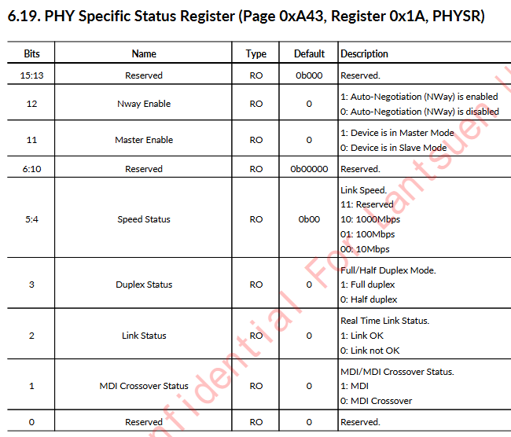
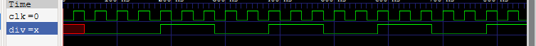

# 1.1. PHY review and PHY Register Reads
## 16/08/2026
Deciding key params for implementation (implemented on a AX7A035B Development board w. xc7a35tfgg484-2)
- **FPGA board**: XC7A35T
- **PHY**: JL2121-N040I Ethernet PHY chip
- **PHY MDIO address**: 1
- **Board clk freq**: 200MHz

## 18/08/2026
Continued to review key params required....
- **RGMII pin names**: See below img
- **MDIO pins**: See below img
- **PHY reset pin**: See below img

- **MAC address - selected for the board**: 2E.FC.32.BA.7C.99
- **Host MAC address**: 4C:56:DF:3C:A3:51
- **IP address**: To be chosen at bring-up, not assigned by anything. The board and my laptop will be the only two devices on a direct cable, so I pick a private subnet, give the laptop's Ethernet adapter a manual address on it, and give the board a different host address on the same subnet.
- **Toolchain**: Vivado (Questa for simulation)

## 20/08/2026
Read PHY schematic pgs 0-15

## 24/08/2026
Skimmed PHY schematic pgs 15-60

## 25/08/2026
Adding basic PHY resetting logic
PHY_reset.v 

## 26/08/2026
- Reviewed RGMII interface, MDIO sub interface, and UART
- Built out PHY_init.v module w. 20ms reset and assert length (10ms specified on PHY datasheet, 20ms selected for margin of safety). 

## 27/08/2026
- Drafted **MDC generator**
- Started work on the **MDIO master**. Two wires, MDC and MDIO. 
- Important Figures from PHY datasheet:

## 30/08/2026
- Tested MDC generator w. MDC_tb.v
- Added makefile for quick testing using verilator

## 31/08/2026
- Wrote preliminary MDIO.v + MDIO_tb for it
- Tested using questa sim

## 02/09/2026
- Started work on allowing MAC to read the PHY status register
- (This one - BMSR: page 0x00, register 0x01 - See PHY datasheet)

## 03/09/2026
- (Dated)--> Determined to keep enable logic in MDIO_master as opposed to MDIO to prevent me from having to redesign MDIO in future iterations
- ^ Changed my mind on this as this would ultimately just be putting a wrapper around a tristate buffer
- Moved over to FSM structure for clarity --> was using counter for too many things

## 04/09/2026
- Fleshed out FSM, finished read-only MDIO design

## 06/09/2026
- Completed MDIO Master for read status regs only
- Added top.v
- Recognised issue - board clk is 200 MHz, need 25 MHz for circuit to operate as intended. - Use Vivado tools

## 07/09/2026 - 1
- Determined to use PLL over MMCM as integer division is all that's needed.
- Tested Vivado CLocking Wizard - adapted to AMD part

## 07/09/2026 - 2
- Used Vivado clocking wizard to create pll which divides native clock of 200 MHz down to 25 MHz.

## 09/09/2026 - 1
- Added reset chaining. PLL locked --> PHY init --> MDIO init
- Added Syncs to MDIO input - as PHY clock is separate this reduces risks of metastability

## 09/09/2026 - 2
- drafted first constraints file.
- added ila debugging
- ran synthesis and implementation in Vivado

## 10/09/2026
- Generated bitstream
- Programmed board
- identified that MDIO read data is delayed 1 bit

- i.e. 0x7949 << 1, with a 1 shifted in  =  0xF293
- Reduced turnaround time by one clock cycle, issue resolved.

# 1.2. PHY Register Writes
## 03/10/2026
- Confirmed 1.1. (PHY reg reads) complete
- Modified MDIO to now permit reg writes
- Generated tb using claude, confirmed all tests passed
- Modified MDIO master to write to control reg 0, seting Ethernet Speed to 100 Mbps. Confirmed with following screenshots on Vivado and PC

- Set eth adapter to 100 Mbps (full duplex)
# 1.3. and 1.4. Frame receiving and transmitting

- Started work on RGMII receiving using DDR registers

## 04/10/2026
- Added BUFG to RGMII receiver
- Researched Async FIFOs for inter CD data transfer

- Created FIFO memory
- Wrote write pointer handler
- Wrote write pointer handler
- Created top level RGMII
- Added to top level module for raw nibble review
- Confirmed nibbles received in Vivado ila after synthesis and implementation. See ila waveform capture below of Vivado hardware detection. 

## 05/10/2026
- Extracted full bytes
- Began work on frame error handling and frame receiver. 
- Researched CRC

## 06/10/2026
- Researched CRC...

## 07/10/2026
- Reworked frame receiver into byte parser
- Handled undetected end of frame bug - last edge not being written to FIFO due to the usage of a register over a wire in the FIFO write enable logic.

## 08/10/2026
- Researched CRC, how to implement it in digital logic
- Streamlined byte parsing logic, reducing reg count

## 11/10/2026
- Completed CRC checking and error checking (outputs good frame flag)
- added basic transmitting of message "hello"

## 12/10/2026
- Tested CRC - Confirmed simple 100 Mbps tranmission and reception working

# 2.1 Updating to Auto-negotiation
## 13/10/2026
- Reasoned about frame processing using microsoft paint ;) 

## 14/10/2026
- Reviewed next steps.. decided to extend to a **Network Packet Analyser** 
- Main advantage over wireshark is accurate PHY arrival timestamps

## 15/10/2026
- debugged BUFG → BUFIO/BUFR timing bug
- Updated clock speed (Using clocking wizard from vivado) - reviewed fanout signals theory
- Added Johnson counter to produce MDC
- Confirmed status register to read once auto-negotiation is complete.

## 17/10/2026
- Completed auto-negotiation functionality
- Completed "cut-through parsing" on incoming ethernet frames

## 18/10/2026
- Completed incoming frame filtering

## 20/10/2026
- Fixed receiving compile errors
- Began work on transmission side - DDR output - different clocks for different transmission rate modification required.

## 26/10/2026
- Wrote logic to divide a clk by N where N is an odd number - used for PHY RGMII interface

## 27/10/2026
- Streamlined divide by odd N clk. 

